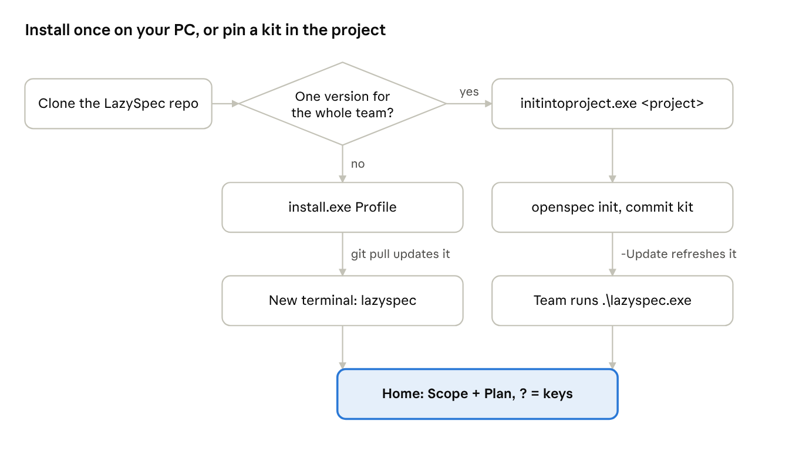
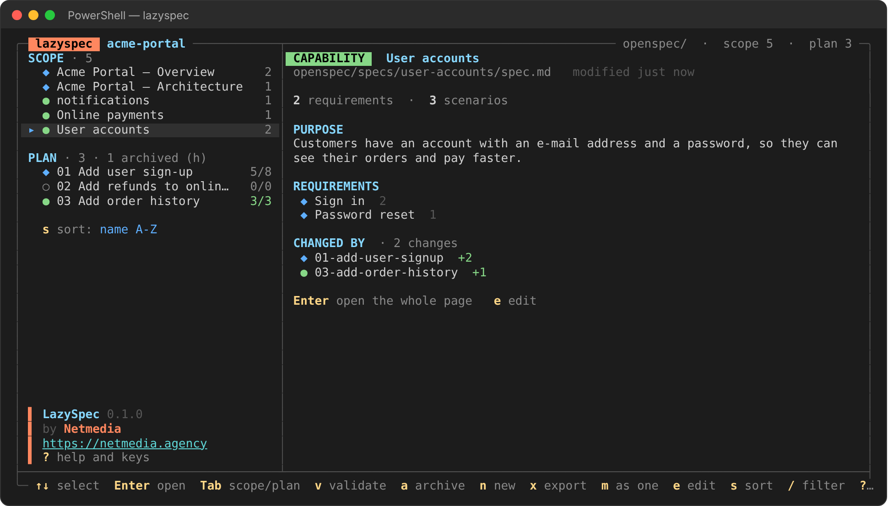
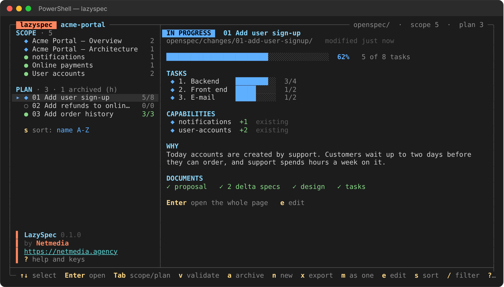
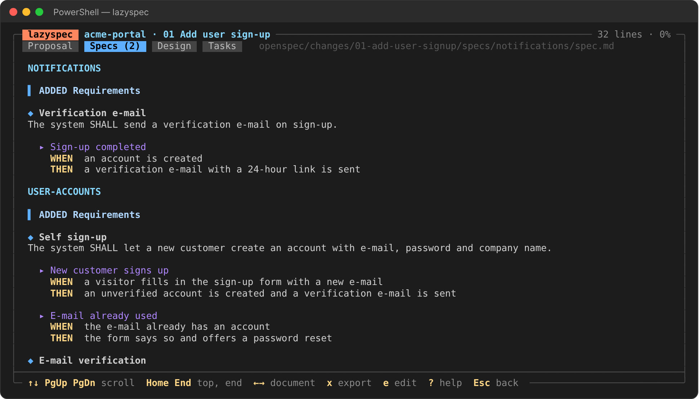
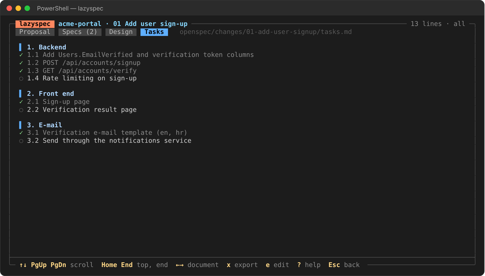
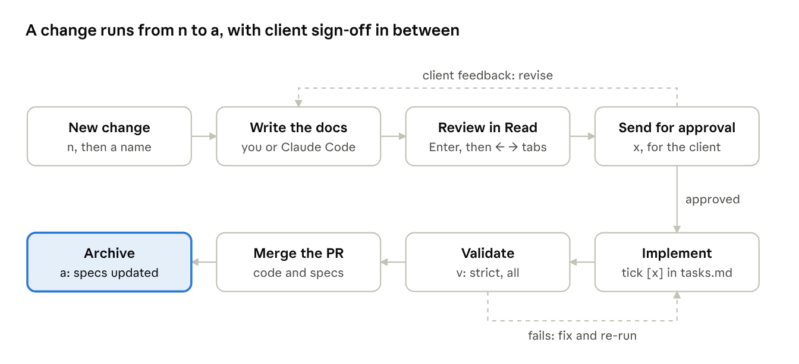
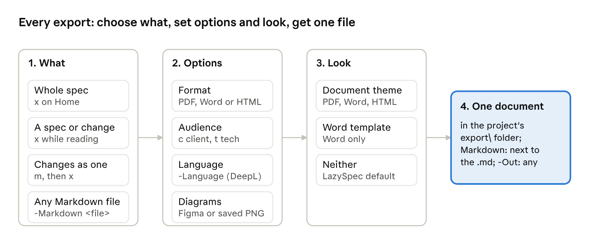
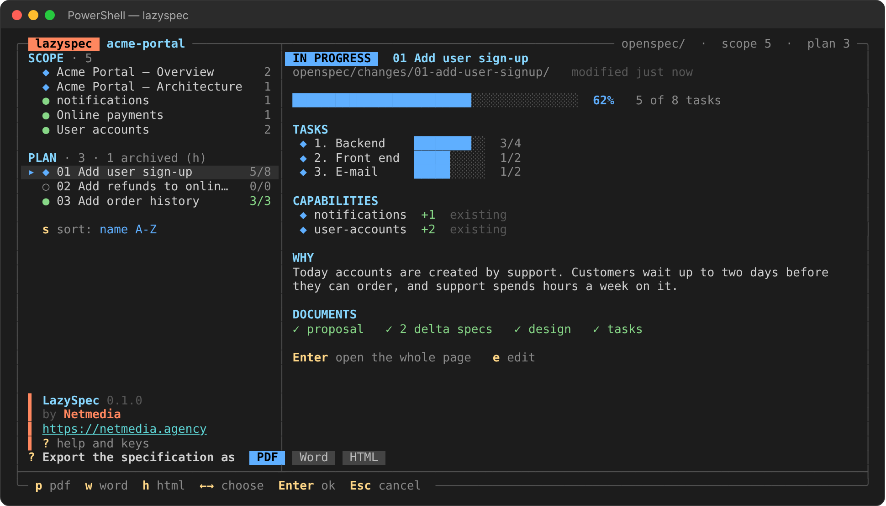
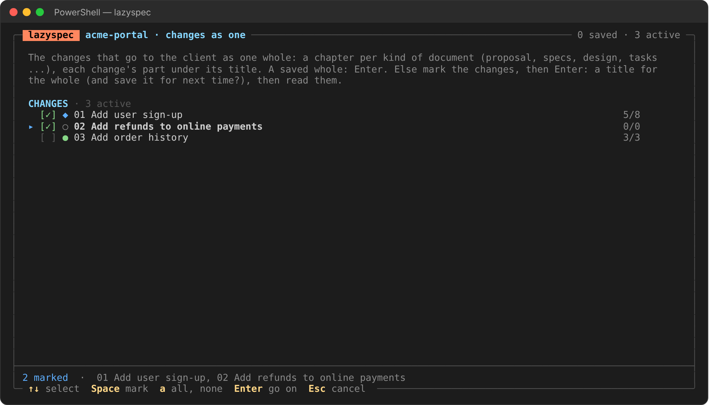

# LazySpec — Developer Guide

How to install LazySpec, add it to a project, and use it day to day. Full reference: [`tools/lazyspec/LAZYSPEC.md`](../tools/lazyspec/LAZYSPEC.md).

## What LazySpec is

LazySpec shows a project's OpenSpec specs and changes on one terminal screen and turns them into client-ready PDF, Word or HTML documents. It is the sibling of LazyBicep: same look, same keys, same technology (PowerShell, no modules). It runs on **Windows** (Windows PowerShell 5.1 or PowerShell 7) and **macOS** (PowerShell 7): the same `.ps1` on both.

Use it when a project follows spec-driven development with [OpenSpec](https://github.com/Fission-AI/OpenSpec) and you want to:

- browse `openspec/specs/` (platform pages and capability specs) and `openspec/changes/` (stage, task progress, capabilities touched) without opening files one by one;
- read any spec or change formatted for the terminal (requirements, scenarios, tasks, tables);
- run the OpenSpec CLI (validate, archive, new change) and see its output in the same screen;
- export the specification, one change, or several changes as one document for the client, in the company look, optionally translated.

It works alongside the OpenSpec CLI, openspec-ui and coding agents such as Claude Code: it reads the same files and refreshes by itself when they change.

**Source:** `git@github.com:netmedia/lazyspec.git` (branch `develop`). Every script explains itself with `-Help`.

## Install from scratch (on your PC)

Install LazySpec once per PC, then type `lazyspec` anywhere inside a project. Nothing goes into the project.

### Prerequisites

| Need | For | How |
| --- | --- | --- |
| Windows PowerShell 5.1 or PowerShell 7 | Everything (Windows) | Built into Windows |
| PowerShell 7 | Everything (macOS) | `brew install powershell` |
| OpenSpec CLI | Actions: validate, archive, new change, `openspec init` | `npm install -g @fission-ai/openspec` |
| Execution policy that runs local scripts | The `Profile` install | `Set-ExecutionPolicy -Scope CurrentUser RemoteSigned` |
| Microsoft Edge or Google Chrome | The data-model diagram in Word and PDF | Windows: Edge is always there. macOS: Chrome or Edge in `/Applications` |
| Python 3.10+ with `python-docx` | Word and PDF export (netmedia-document makes them) | The Netmedia environment `~/.netmedia/python`, or python.org; then `python -m pip install python-docx` |
| Microsoft Word | PDF export (it exports the Word document); the contents' page numbers | Windows or macOS (Word for Mac) |
| DeepL key in `DEEPL_AUTH_KEY` | Export in another language | Optional, see Integrations |
| Figma token | Fresh FigJam diagrams in exports | Optional, see Integrations |

### Steps

1. Clone the repo: `git clone git@github.com:netmedia/lazyspec.git D:\Development\Netmedia\LazySpec`
2. In the repo, pick an install mode:
   - `.\install.exe Profile` — a `lazyspec` function in your PowerShell profiles. Runs the project's own copy if it has one, else this repo's copy. A `git pull` updates it. **Recommended for developers.**
   - `.\install.exe Global` — a copy in `%LOCALAPPDATA%\Programs\LazySpec` on your user PATH. Works in cmd and other shells. Fixed version until you reinstall.
   - `.\install.exe Both` — the project's copy first, else the global one.
3. Open a **new** terminal.
4. `cd` into any project with an `openspec\` folder and run `lazyspec`.

LazySpec finds the project as the nearest folder with `openspec\` above the current folder, so you can start it from any subfolder.

### On macOS

The `.exe` launchers and `install` are for Windows; on macOS start the `.ps1` with `pwsh`.

1. `brew install powershell` (once).
2. Clone the repo, e.g. to `~/Development/LazySpec`.
3. In a project with its own kit: `pwsh tools/lazyspec/lazyspec.ps1`. Without a kit: `pwsh ~/Development/LazySpec/tools/lazyspec/lazyspec.ps1` inside the project, or with `-Root <project>`.
4. Plain `lazyspec` in every terminal: an alias to the repo's copy (a `git pull` updates it):
   - zsh: `echo "alias lazyspec='pwsh -NoProfile -File ~/Development/LazySpec/tools/lazyspec/lazyspec.ps1'" >> ~/.zshrc`
   - fish: `alias --save lazyspec 'pwsh -NoProfile -File ~/Development/LazySpec/tools/lazyspec/lazyspec.ps1'`
5. Put the kit into a project with `pwsh initintoproject.ps1 <project>`.

Keys on a Mac: `⌃T` `⌃U` `⌃Y` `⌃S` (Control) work as on Windows - LazySpec turns the terminal's own uses of them off while it runs; or `⌥T` `⌥U` `⌥Y` `⌥S` (Option) once the terminal sends Option as Meta (Terminal: *Use Option as Meta key*; iTerm2: *Left Option key: Esc+*). `Del` is `fn ⌫`, `Home` `End` `PgUp` `PgDn` are `fn` with the arrows; the help shows them that way.

Differences from Windows: PDF needs Word for Mac; without it a Word document gets its contents' page numbers when you open it in Word (right-click the contents, Update Field); per-user data (the translation cache) is in `~/Library/Application Support/LazySpec`. Paths in `openspec/config.yaml` may use `/` or `\` on both systems.

### Verify

- `lazyspec -Help` prints the guide.
- In a project, `lazyspec` opens the Home screen; `?` shows the keys.
- `openspec --version` answers (needed only for the actions).

### Keep it current or remove it

| Command (in the repo) | What it does |
| --- | --- |
| `git pull` | Updates a `Profile` install immediately |
| `.\install.exe Update` | After a pull: the global copy and the profile function get the new version (old → new shown) |
| `.\install.exe -Uninstall` | Removes the function and the global copy |

The `.exe` files are thin launchers for the `.ps1` of the same name, so no execution policy prompts and double-click works. They aren't code-signed; SmartScreen may ask once on a new PC.

## Add LazySpec to a project

Put the kit into the project when the whole team should run the same version without installing anything. A project's own copy always wins over a PC install.



Both paths end on the same Home screen; a project's own kit always wins over the PC install.

### Which way to choose

| | Installed on the PC | In the project (kit) |
| --- | --- | --- |
| What lives where | Nothing in the project | `tools\lazyspec\` + `lazyspec.exe` in the root, committed |
| Set up | `.\install.exe Profile` once per PC | `.\initintoproject.exe <project>` once per project |
| Start | `lazyspec` anywhere in the project | `.\lazyspec.exe` in the root (or `lazyspec` with the profile function) |
| Version | The repo's (`git pull`) or the global copy's | The project's: same for everyone |
| Settings file | `lazyspec.json` in the project root | `tools\lazyspec\lazyspec.json` |
| Best for | Internal projects, people who use it everywhere | Client projects, mixed teams, CI-like reproducibility |

### Scenario A: new project, no OpenSpec yet

1. From the LazySpec repo: `.\initintoproject.exe D:\Development\Netmedia\MyProject` (add `-DryRun` first to preview).
2. `cd D:\Development\Netmedia\MyProject`
3. `openspec init` — creates `openspec\` (LazySpec never creates or touches it).
4. `.\lazyspec.exe`
5. Add `.lazyspec/` to `.gitignore`, and `openspec/exports/` too (or decide to commit what was sent to the client).
6. Commit `tools\lazyspec\` and `lazyspec.exe`.

### Scenario B: existing project that already uses OpenSpec

Same as A without `openspec init`. LazySpec reads the existing `openspec/specs`, `openspec/changes` and any custom workflow schema immediately.

### Scenario C: use the PC install only (no kit)

Nothing to add. Optionally create `lazyspec.json` in the project root for settings, and a `lazyspec:` block in `openspec/config.yaml` for export settings. Tell the team to install LazySpec on their PCs.

### What gets created

| Path | What | Replaced by `-Update` |
| --- | --- | --- |
| `lazyspec.exe` (root) | Launcher, so it starts from the root | Yes |
| `tools/lazyspec/lazyspec.ps1` | The program | Yes |
| `tools/lazyspec/lazyspec.exe` | Launcher | Yes |
| `tools/lazyspec/kit.json` | Version + list of kit files | Yes |
| `tools/lazyspec/LAZYSPEC.md` | Full reference | Yes |
| `tools/lazyspec/export-texts.json` | Export texts per language (en, hr, de, nl) | Yes |
| `tools/lazyspec/lazyspec.json` | Project settings (you create it) | No, kept |

### Update or remove the kit

- **Update:** `.\initintoproject.ps1 <project> -Update` replaces the kit files; `openspec/` and `lazyspec.json` stay.
- **Remove:** `.\initintoproject.ps1 <project> -Remove [-DryRun]` deletes the kit and moves `tools\lazyspec\lazyspec.json` to `lazyspec.json` in the root. Commit the removal; the team then installs LazySpec on their PCs.
- **Install on a PC from a project's kit:** `.\lazyspec.exe -Install Profile|Global|Both`, `.\lazyspec.exe -Uninstall`.

In PowerShell always type `.\lazyspec.exe` (or `.\lazyspec`): PowerShell never runs a program from the current folder by name alone. In cmd, `lazyspec` is enough.

## The screens and keys

**The same keys everywhere:** `t` find, `u` undo, `y` out of date - the letter on every screen where nothing is typed, and `Ctrl+T`, `Ctrl+U`, `Ctrl+Y` on every screen, also while typing (`Alt+` the same; on a Mac `⌃` or `⌥`, see *On macOS*). In the item editor, save (`Ctrl+S`) or leave it (`Esc`) first. `Esc` brings you back to where you were.

LazySpec has five screens; Home is where you start and `?` always shows the keys.

| Screen | How you get there | What it shows |
| --- | --- | --- |
| Home | Start | Left: **Scope** (specs) and **Plan** (changes). Right: a summary of the selected item |
| Read | `Enter` | The whole spec, or a change's documents as tabs (proposal, delta specs, models, design, tasks ...) |
| Changes as one | `m` | Saved bundles on top, active changes below; mark changes that go to the client together |
| Find | `t` (`Ctrl+T` anywhere) | Tasks, requirements, scenarios and sections matching what you type, with the document each is in; `Enter` opens one in Read, at it |
| Undo | `u` | Every change to `openspec/` since the last commit, piece by piece; undo one, or a whole file |
| Run | `v`, `a`, `n`, `x` | OpenSpec CLI or export output, coloured (✓ passed, ✗ failed, ⚠ warnings) |
| Help | `?` | Keys and credits |

**List symbols.** Scope: `◆` platform page (`platform-*`), `●` capability spec, with requirement count. Plan: `○` draft (no tasks), `◆` in progress, `●` completed, `·` archived (shown with `.`), with done/total tasks and a bar.

**Details pane.** A spec shows requirement and scenario counts, purpose, requirements and the changes that will touch it (`+` added, `~` modified, `-` removed). A change shows progress, tasks by group, capabilities touched, why, and which workflow documents exist (`✓` done, `○` not yet).

### What it looks like

The screenshots below come from LazySpec itself, run on a made-up demo project (Acme Portal).

**Home, a spec selected:** its purpose, its requirements, and the changes that will touch it.



**Home, a change selected (Tab to Plan):** progress, tasks by group, capabilities, why, and which documents exist.



**Read, delta specs tab:** requirements as `◆`, scenarios as `▸` with WHEN / THEN. Use `←` `→` to switch between Proposal, Specs, Design and Tasks.



**Read, tasks tab:** done tasks `✓`, open ones `○`, by group.



### Keys

| Screen | Keys |
| --- | --- |
| Home | `↑` `↓` select · `Tab` / `Shift+Tab` next / previous pane (Scope, Plan, Undo, details) · `→` into details, `←`/`Esc` back · `z` zoom details · `PgUp` `PgDn` `Home` `End` scroll details · `Enter` read · `p` `s` `d` plan, scope, details · `h` back to the document · `v` validate all · `A` archive change · `n` new change · `x` export · `m` changes as one · `Space` choose a group · `c` fold a group · `g` grouped/flat · `t` find · `y` out of date · `u` undo · `e` edit · `o` sort · `.` archived · `/` filter · `r` refresh · `?` help · `q` quit |
| Read | `↑` `↓` pick a task, requirement, scenario or section (else scroll) · `Enter` edit it · `Space` done/not · `Del` delete · `a` agent · `PgUp` `PgDn` scroll · `←` `→` previous/next document · `x` export this item · `e` the whole file · `t` find · `u` undo · `y` out of date · `Esc` back |
| Changes as one | `↑` `↓` select · `Space` mark · `a` all/none · `Enter` continue · `d` remove saved bundle · `Esc` cancel |
| Find | type · `↑` `↓` select · `Tab` all / tasks / open tasks / requirements / scenarios / sections · `Shift+Tab` the document · `Enter` open in Read · `→` mark (`Space`, `a`, `g`), then `Del` delete or `Enter` delete / change / write again · `Esc` back |
| Edit | type · arrows `Home` `End` move · `Enter` new line · `Ctrl+S` save · `Esc` cancel |
| Undo | `↑` `↓` select · `Enter` undo it · `r` refresh · `Esc` back |
| Run | `PgUp` `PgDn` `Home` `End` scroll · `Esc` stop (asked first); when done `Enter`/`Esc` back |

The screen refreshes by itself when files under `openspec/` change, whether from your editor, git or an agent.

## Workflows in a project

Each scenario below is a recipe: when to use it, then the steps. Commands are shown as `lazyspec`; with a project kit in PowerShell use `.\lazyspec.exe`.

### Typical change lifecycle



LazySpec refreshes as files change, so you can keep it open through every step; the dashed lines are the two loops: client feedback and failed validation.

### 1. Get an overview of the project

**When:** starting the day, joining a project, before a client meeting.

1. `lazyspec` in the project.
2. Scope list: platform pages first (overview on top), then capability specs.
3. `Tab` to Plan: each change's stage and task progress.
4. `o` cycles sort (name A–Z, Z–A, recently modified); `/` filters; `.` shows archived changes; `p`, `s`, `d` jump to the plan, the scope and the details; `h` goes back to the document last read.
5. `z` widens the details pane for a long summary.

### 2. Start a new change

**When:** a new feature, fix or refactor needs a spec before code.

1. Home, `n`, type the name (spaces become `-`, e.g. `add-user-signup`).
2. LazySpec runs `openspec new change <name>` and shows the output.
3. The change appears in Plan as `○` draft. `e` opens its proposal in `$VISUAL`/`$EDITOR`, else VS Code.
4. Number changes (`01-...`, `02-...`) if you want the Plan list in delivery order.

### 3. Review a change or spec

**When:** code review of a spec, checking an agent's output, preparing questions for the client.

1. Select it, `Enter`.
2. `←` `→` switch documents in the order the change's workflow schema defines; other `.md` files in the folder come last.
3. `e` edits the document you're reading; the view refreshes on save.

### 4. Track implementation progress

**When:** during development and standups.

- Progress comes from `tasks.md` (`## 1. Group` + `- [ ]` / `- [x]`), or the file the schema's `apply.tracks` names.
- Plan shows done/total and a bar; the details show tasks by group.
- A change with all tasks ticked turns `●` completed.

### 5. Validate

**When:** before a commit or PR, after an agent wrote specs.

1. Home, `v` — runs `openspec validate --all --strict --no-interactive`.
2. Fix anything marked `✗`, then `v` again.

### 6. Archive a finished change

**When:** the change is implemented and merged.

1. Select it, `a`. LazySpec asks first and shows the open task count.
2. It runs `openspec archive <change> --yes`: delta specs merge into `openspec/specs`, the folder moves to `changes/archive/<date>-<name>/`.
3. Commit the result.

### Exports at a glance



Scenarios 7 to 11 are all the same pipeline: the UI asks the options in order, the command line takes them as parameters, and the project's `config.yaml` decides the look.

### 7. Export the whole specification for the client

**When:** a functional specification, an offer annex, a milestone sign-off.

1. Home, `x`, pick format: `p` PDF, `w` Word, `h` HTML.
2. With active changes: specs only, or with the plan (active changes after the specs).
3. `c` for the client (scenarios as plain sentences, `MUST`-style keywords removed) or `t` technical (as written).
4. The file lands in `openspec\exports\<project>-specification-<date>.<ext>` and opens (another folder: `lazyspec: exportDir:`).

Every export has a cover and a contents; in PDF the contents shows page numbers with dot leaders, as Word's does (LazySpec prints the PDF twice for that). Tables get column widths from their content: short columns as wide as their longest word or identifier, the rest to the longest text, the same in PDF, HTML and Word.



Command line: `lazyspec -Export Pdf`, `lazyspec -Export Word -IncludeChanges -ClientFriendly -Open`, `-Out D:\Clients\X.pdf` to write elsewhere.

### 8. Export one change or spec

**When:** sending a single feature proposal for approval.

1. Open it (`Enter`), `x`, pick format and client/technical.
2. Output: `openspec\exports\<project>-<name>-<date>.<ext>`, a chapter per workflow document.

Command line: `lazyspec -Export Pdf -Item add-user-login`.

### 9. Export several changes as one document

**When:** a release or a client order spans several changes.

1. Home, `m`. `Space` marks changes (`a` all/none), `Enter`.
2. Give a title (on the cover and in the file name); choose `s` to save the bundle or `n` not now.
3. Read shows them together, one tab per document kind; `x` exports.
4. Saved bundles sit in `openspec/config.yaml` under `lazyspec: bundles:` and appear at the top of `m` next time.



Command line: `lazyspec -Export Word -Item add-user-signup,add-online-payments -Title "Online payments"`, or `-Item <bundle-key>`.

### Groups: phases, modules, packages

**When:** the client chooses what to order by phase or module (groups 1, 3 and 7 now, the rest later).

1. List the groups in `openspec/config.yaml` (top level): `groups:` with `id`, `name`, optional `description` and `requires: [<ids>]`. `groupLabel` / `groupLabelPlural` say what they're called (default Group/Groups; e.g. Phase/Phases).
2. Each change names its group: `x-group: <id>` in its `.openspec.yaml` (fallbacks: the line `Group: <id> – <name>` under its first document's title, the folder prefix `g<id>-`). The schema's `grouping: [group]` turns grouping on.
3. Home shows the plan by group: a row per group with its changes and task progress. `c` folds a group, `g` toggles grouped/flat; the group's details list what it requires, its capabilities and cross-group dependencies.
4. `Space` chooses groups; the groups they require come along (`+`). `Enter` reads them, `x` exports one document: a part per group, its changes under it, the group names on the cover.
5. Find in one group: `t`, then `g1` or `group 1` with your words.

Command line: `lazyspec -Export Pdf -Groups 1,3` (with the groups they require), `-Item group:2` (that group alone). A saved bundle can hold `groups: 1, 3` instead of `changes:`.

### 10. Turn any Markdown into a branded document

**When:** meeting notes, summaries, letters to the client.

1. Write the `.md` anywhere inside the project; add optional front matter (`title`, `subtitle`, `client`, `author`, `date`, `language`, `toc`, `cover`).
2. `lazyspec -Export Word -Markdown "openspec_meetings\2026-11-04 summary.md"` (or `Pdf`, `Html`).
3. The document is written next to the `.md` in the project's theme or template.
4. Pictures: a line with only `` (the path relative to the `.md`) puts the picture in, the page's width at most, the caption under it. A `|` inside a table cell is written `\|`.

### 11. Export in another language

**When:** specs are written in Croatian but the reader speaks English or German (or the reverse).

1. Set up DeepL once (see Integrations).
2. `lazyspec -Export Pdf -Language en`; for DeepL beta languages such as Croatian add `-Beta`.
3. Exports into Croatian are checked by Hasek/ispravi.me; findings go to `<document>.hasek.md`. Nothing is changed automatically.
4. Translations are cached in `%LOCALAPPDATA%\LazySpec\translations\`, so re-exports cost no DeepL characters.

### 12. Add diagrams from FigJam

**When:** a change or capability has a flow drawn in FigJam or Figma.

1. In FigJam: select the section, Copy link to selection.
2. Add it under `lazyspec: diagrams:` in `openspec/config.yaml` (per change: `change:` for the whole change, or per capability), or point to an image file.
3. Export once with a Figma token: the PNG is saved in the change's `diagrams\` folder, the space around its part of the process cut off. Commit it so exports work for everyone without Figma.
4. `-KeepDiagrams` uses saved images only; `-RefreshDiagrams` always fetches the latest.
5. Placement: the whole change's diagram (`change:`) opens the Specifications chapter, before the list of capabilities; a capability's diagram opens that capability. All diagrams of a change from the same Figma file are shown at the scale of the whole change's diagram, so the boxes are equally large everywhere.

### 13. Give documents the company look

**When:** any project whose documents go to a client.

- **Word and PDF are Netmedia documents** (netmedia-document): the Netmedia cover, contents, styles, header and footer, the latest Netmedia template by default.
- **The project's own copy of the template:** `documentTemplate:` pointing to a `.docx` (`netmedia:openspec-init` puts `openspec/artifacts/Document template.docx` there; `netmedia-document:theme` refreshes it). It keeps the cover's `DOCUMENT TITLE` paragraph and the `Table of contents` title.
- **HTML:** `documentTheme:` pointing to a YAML in the project, with `fonts/` and logos next to it; not set, `openspec/artifacts/document-theme.yaml` when it's there. Start from [`examples/document-theme/document-theme.yaml`](../examples/document-theme/document-theme.yaml).
- `-Template` / `-Theme` override for one export.

### 14. Work alongside Claude Code

**When:** an agent writes or updates specs, designs and tasks.

1. Keep LazySpec open in a second terminal pane.
2. As the agent writes files under `openspec/`, Home and Read refresh by themselves.
3. Review what it wrote in Read, `v` to validate, then commit.

### 15. Custom workflow schemas and models

**When:** the project uses its own OpenSpec schema (e.g. `feature`, `greenfield`).

- LazySpec finds the schema as the CLI does: the change's `.openspec.yaml`, then `openspec/config.yaml`, then `spec-driven`.
- Read gets one tab per artifact in the schema's order; the details list each as `✓` or `○`.
- A `models.md` artifact gets its own tab and export chapter; tables whose first column is *Change* / *Promjena* colour `+` `~` `-` rows, and the export draws a models diagram from ``### `Name` `` headings and `**Relations:**` / `**Veze:**` lines.
- The schema's `language:` sets the export language (`hr`, `en`, `de`, `nl`).

### 16. Find a task, a requirement or a scenario

**When:** "where is task 1.3?", "which change handles refunds?", a standup, a question from the client.

1. `t` (on any screen where nothing is typed; `Ctrl+T` on any screen, also while typing), and type: a task number (`1.3`: in every change), a change and a number (`01 1.3`, `signup 1.3`), or words (`verification`, `refund e-mail`): every task, requirement, scenario and section (`## Why`, `### ADR-001` ..., by its text too) that contains them all. Each result shows the document it is in (Proposal, Specs, Design, Tasks, Models ...).
2. `Tab` narrows it by kind (all, tasks, open tasks, requirements, scenarios, sections), `Shift+Tab` by document.
3. `Enter` opens it in Read, on the tasks or the specs tab, scrolled to it and marked `▸`; `Esc` returns to the results, `Esc` again to the screen you came from.
4. Archived changes are searched only when shown on Home (`.`).
5. With groups: `g1` or `group 1` (or the project's word, `phase 1`) next to your words keeps one group.
6. Item ids: a task line, a requirement or scenario heading, or an open question's or decision's list line can start with an id, `<KEY>-<KIND>-<nn>` (`- [ ] 1.1 OSN-T-04 ...`, `### Requirement: OSN-R-03 ...`, `- OSN-Q-02 ...`; KIND: T task, R requirement, S scenario, Q open question, D decision). Type the id or its beginning, in any case: `OSN-T-04` (that one first, then `OSN-T-040`, `OSN-T-041` ...), `OSN-T-0`, `OSN-T` (every OSN task), `osn` (every OSN item by id, then text with the word). The id is shown as a label of its own in the results.
7. `openspec/keys.yaml` (written by the tool that hands out the ids; flow style, an entry a line) names the keys and the retired ids: `retired: - {id: OSN-T-11, reason: split, into: [OSN-T-73, OSN-T-74]}`. Typing a retired id shows "OSN-T-11 - split into OSN-T-73, OSN-T-74" (or "removed") and the successors after it.
8. `openspec/project-tasks.md`: the project's own tasks (pre-project, after development, infra), in the tasks format with `## <n>. <section>` headings, are found as *Project tasks* (and shown first in the VS Code plan).

### 17. Clean up: remove, change or redo tasks, requirements and scenarios

**When:** specs and tasks came from a prototype, a workshop or an agent, and some of it has to go or be redone.

**One item:** open the spec or change (`Enter`), go to its tab (`←` `→`), and `↑` `↓` pick the task, requirement, scenario or section such as the proposal's `## Why` (marked `▸`).

- `Enter` edits only that item in a window (`Ctrl+S` saves it into its file, `Esc` cancels). In a main spec you choose: directly, or through a change (`MODIFIED`), as OpenSpec prefers.
- `Space` ticks a task done or not done; `Del` deletes the item (asked first); `a` hands it to the agent (change it with your note, or write it again).

**Several at once:**

1. `t`, find them (a word such as `prototype`, a task number, a capability), `→` into the results.
2. Mark: `Space` one, `a` all the results, `g` a task's whole group or a requirement's whole capability. Marks stay while you search for more.
3. `Del` deletes them (asked first): out of the change's documents; for the main specs, a new change with `REMOVED Requirements` (archive it to apply it). LazySpec validates afterwards.
4. `Enter` on the marked: delete, change (type what), write again (from the current specs) or unmark. Change and write again go to the agent, see below.

### 18. Keep tasks in step with the specs

**When:** a spec was changed (by you, the client's feedback, an agent) after the tasks were written.

1. The change shows `!` in Plan; its details list *OUT OF DATE*: which document, and which requirements were added (`+`), changed (`~`) or removed (`-`).
2. `y`: **update them** (the agent gets exactly what changed, before and now) or **mark them as in sync** if nothing needs to change.
   - In the background: when the agent ends with 0 and `openspec validate <change>` passes, the change is marked as in sync by itself.
   - Here: LazySpec asks on your return.
   - Either way, a spec someone edits during the run still shows as out of date.
3. The first time, LazySpec asks whether to watch for this in the project (`lazyspec: syncCheck:`).

**The agent:** each time LazySpec hands work to Claude Code it asks how:

- **Here** (`h`, recommended): Claude Code takes over this terminal with the prompt. When it asks you to choose (1, 2, 3 ...) or to approve, answer it there; `/exit` (or `Ctrl+C` twice) brings you back to LazySpec, which reads the documents again.
- **In the background** (`b`): its output in the run screen, without questions (it decides and says what it decided). When it's done, `a` sends it your answer or more to do, in the same conversation.
- **Save the prompt** (`s`): in `.lazyspec/prompts/`, the command copied, e.g. `claude "Read the file .lazyspec/prompts/... and do exactly what it says."`.

Your answer is the default next time (`lazyspec: agent:`). Add `.lazyspec/` to `.gitignore`.

### 19. Undo since the last commit

**When:** a removal, a sync or an agent's edit didn't turn out as you wanted.

1. `u` lists every change to `openspec/` since the last git commit, by file and by piece, the selected piece shown (red: before, green: now).
2. `Enter` undoes the piece (asked first); on a file's row, the whole file back as committed, or a new file deleted.
3. A commit empties the list. It needs the project in git.

### 20. Work in VS Code, Cursor or Windsurf

**When:** you'd rather stay in your editor than switch to a terminal.

1. Install the extension once, from the LazySpec repository's root: `.\install-vscode.exe` (macOS, Linux: `./install-vscode.sh`). It installs `vscode/lazyspec.vsix` in every VS Code, Cursor, Windsurf and VSCodium it finds (`-Editor cursor`: only that one). Run it again after a `git pull` to update.
2. Open the project's folder (`code .` there). The LazySpec sidebar opens by itself. It has the **Plan** (by group when the project has groups; `!` on out-of-date changes), the **Scope**, the **Details** of what you select, and **Undo**.
3. **Edit** opens the item (or a document clicked in the trees) in a **formatted editor**: a bar with headings, bold, italic, lists, task lists, tables, links; Save and Cancel. Only the lines you change are written back; the rest of the file stays as it was. The title bar of any Markdown file has **Formatted** and a **LazySpec** menu (source, preview, Read, export). **Refresh** (⟳ in the views' title bars, Refresh in Read and Details) reads everything again; in the terminal version `r` does, on Home and in Read.
4. **Read** (the book button, `Ctrl+Alt+R`) shows a change, spec, group or changes as one, formatted, with a tab per document. Click a task, requirement, scenario or section (`Ctrl`-click for several), then use **Edit**, **Done**, **Delete** or **Agent...**. **Source** opens the Markdown.
5. In the trees, every document has its sections, tasks have checkboxes, and specs open down to requirements and scenarios. On an item: `F2` edits, `Space` ticks a task, `Delete` deletes (asked first; from the main specs through a change), and `Ctrl+Alt+A` hands it to the agent. Select several with `Ctrl`/`Shift`. A document clicked opens formatted or as source (`lazyspec.documents`; right-click for the other).
6. The agent (Claude Code) runs here (a terminal, it may ask), in the background (answer it after), or only saves the prompt. The choice is remembered per project, as in the terminal version.
7. Out of date: **Sync Out-of-Date Documents** on a change with `!` lets the agent update its documents, or marks them as in sync. It uses the same `.lazyspec/sync.json` as the terminal version.
8. **Undo** lists every change to `openspec/` since the last commit, by piece. Click one for its diff; the discard button undoes it.
9. `Ctrl+Alt+T` (Mac `Cmd+Alt+T`) is Find: task numbers, words, `g1` for one group, the kind and document filters, and actions on each result or on several at once.
10. The `...` menu of the Plan holds Validate, Read Changes as One, Read Groups, archived, sort, Export Groups, Export in Another Language, saved wholes and the terminal UI. Right-click any `.md` in the Explorer to export it as a document.
11. Export uses the project's own `tools/lazyspec/lazyspec.ps1` when it has one, else the copy built into the extension; on macOS install PowerShell 7 (`brew install powershell`).

## Configuration and integrations

Settings live in two places: `lazyspec.json` for the UI and export defaults, and a `lazyspec:` block in `openspec/config.yaml` for everything that belongs to the specification. The `config.yaml` values win; the OpenSpec CLI ignores the block.

### lazyspec.json

In `tools/lazyspec/lazyspec.json` (kit) or `lazyspec.json` in the project root (PC install):

```json
{
  "specOrder": ["platform-overview", "platform-functional", "platform-architecture"],
  "export": { "title": "Acme Portal", "subtitle": "Functional specification", "client": "Acme d.o.o.", "author": "Netmedia", "language": "en" }
}
```

`specOrder` sets the Scope list order and the order of exported chapters.

### openspec/config.yaml — lazyspec block

```yaml
lazyspec:
  name: Acme – Portal i javni API              # cover title instead of the folder name
  client: Acme d.o.o.                          # also: subtitle, author, language
  documentTheme: openspec/artifacts/document-theme.yaml
  documentTemplate: openspec/artifacts/Document template.docx
  exportDir: openspec/exports                  # where exports go (the default)
  figmaToken: <prefer FIGMA_TOKEN env var>
  titles:                                      # nicer capability titles in exports
    add-online-payments:
      payment-checkout: Naplata narudžbe
    platform-overview: Pregled platforme
  diagrams:
    add-online-payments:
      change: https://www.figma.com/board/<file>/<name>?node-id=18-350
      payment-checkout: diagrams/checkout.png
  bundles:
    online-placanja:
      title: "Online plaćanja i korisnički račun"
      changes: add-user-signup, add-online-payments
```

### Integrations

| Integration | Used for | Setup |
| --- | --- | --- |
| OpenSpec CLI | `v`, `a`, `n`, `openspec init` | `npm install -g @fission-ai/openspec` |
| DeepL | `-Language`, `-AddLanguage` | `translation:` block in `config.yaml` (`provider: deepl`, `keyEnv`, `english`, `formality`, `hasek`); key via `setx DEEPL_AUTH_KEY "<key>"`, never in `config.yaml` (refused). Free keys end with `:fx` |
| Hasek / ispravi.me | Spell-check of Croatian exports | `translation: hasek: ask \| always \| never` |
| Figma / FigJam | Diagrams in exports | Personal access token with read access to file content; `FIGMA_TOKEN` user env var (keeps it off git) or `figmaToken:` |
| Edge / Chrome | The data-model diagram as a picture | Headless, automatic |
| netmedia-document | Word and PDF export | The installed plugin, else LazySpec's own copy; Python with `python-docx` |
| Microsoft Word | PDF export; the contents' page numbers | Automatic if installed |
| Your editor | `e` | `$env:VISUAL` / `$env:EDITOR`, else VS Code (`code`), else the default app |

The `translation:` block is shared with the netmedia Claude Code plugin (`netmedia:translate`).

### Command-line reference

| Parameter | What it does |
| --- | --- |
| `-Root <path>` | Use this project instead of finding it from the current folder |
| `-Export Pdf\|Word\|Html` | Export without opening the UI |
| `-Item <name>[,<name>]` | One spec/change, several changes as one, or a saved bundle key |
| `-Title <text>` | Cover subtitle and file name for a multi-change export |
| `-IncludeChanges` | Add active changes after the specs |
| `-ClientFriendly` | Scenarios as sentences, normative keywords removed |
| `-Markdown <file.md>` | Export any Markdown file in the project's look |
| `-Theme <yaml>` / `-Template <docx>` | Override the look for one export |
| `-Language <xx>` / `-Beta` | Translate with DeepL; `-Beta` for beta languages |
| `-KeepDiagrams` / `-RefreshDiagrams` | Saved diagrams only / always fetch from Figma |
| `-Out <path>` / `-Open` | Write elsewhere / open when done |
| `-AddLanguage <xx>` [`-Force`] | Add export texts for a new language to `export-texts.json` |
| `-Install Profile\|Global\|Both` / `-Uninstall` | Install from a project's kit |
| `-Keys "Down,Enter,snap" -Frames f.txt` | Scripted key presses for testing; screens written as text |

## Troubleshooting

| Symptom | Cause | Fix |
| --- | --- | --- |
| `lazyspec` not recognised after install | Old terminal | Open a new terminal |
| `lazyspec.exe` / `install.exe` don't run on macOS | They are Windows launchers | `pwsh tools/lazyspec/lazyspec.ps1`, or the shell alias (Install, On macOS) |
| PDF export fails on macOS | No Chrome or Edge in `/Applications` | Install Google Chrome |
| `lazyspec` not recognised in the project root | PowerShell doesn't run programs from the current folder by name | Type `.\lazyspec.exe`, or install the `Profile` function |
| Profile install warns about scripts | Execution policy | `Set-ExecutionPolicy -Scope CurrentUser RemoteSigned` |
| SmartScreen prompt on first run | `.exe` launchers aren't code-signed | Allow once |
| "No project found" | No `openspec\` above the current folder | `cd` into the project, run `openspec init`, or pass `-Root` |
| `v` / `a` / `n` fail | OpenSpec CLI missing | `npm install -g @fission-ai/openspec` |
| Global install is missing new features | Fixed version | `git pull` in the LazySpec repo, then `.\install.exe Update` |
| Export stops with exit code 1 naming a path | Theme, template or logo missing or broken | Fix the path in `config.yaml` (relative to the project root) |
| Export says the file is locked | The previous PDF/Word is open | Close it and export again |
| Warning about a missing font | Font not in the theme's `fonts/` and not installed | Add the `.ttf` to `fonts/` (use `.ttf`, not `.otf`, for Word) |
| Diagram missing from export | No saved PNG and no Figma token | Set `FIGMA_TOKEN`, export once, commit the `diagrams\` PNGs |
| `-Language hr` stops | Croatian is a DeepL beta language | Add `-Beta` |
| DeepL key refused | Key put in `config.yaml` | Use `setx DEEPL_AUTH_KEY "<key>"` and a new terminal |
| Change shows as `spec-driven` with a warning | Its workflow schema can't be found | Check `openspec/schemas/<name>/schema.yaml` and `openspec schema validate` |

This guide as Word and PDF: [`docs/LazySpec-Developer-Guide.docx`](LazySpec-Developer-Guide.docx), [`.pdf`](LazySpec-Developer-Guide.pdf); the reference and the README too, and in [`docs/examples/`](examples/) what a client gets, exported from the demo project [`examples/acme-portal`](../examples/acme-portal/) (try every workflow on it: `cd examples\acme-portal`, `lazyspec`). All made by LazySpec itself in Netmedia's document theme (the AIToolbelt repository's `plugins/netmedia-document/theme/`): `.\docs\build-documents.ps1` after changing the Markdown.

**Where to get help:** `-Help` on any script, `?` in the UI, [`tools/lazyspec/LAZYSPEC.md`](../tools/lazyspec/LAZYSPEC.md) for the full reference, or the LazySpec repo ([github.com/netmedia/lazyspec](https://github.com/netmedia/lazyspec)).
